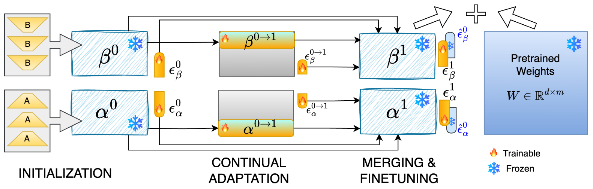

<p align="center">
  
</p>

<h1 align="center">Shared LoRA Subspaces for almost Strict Continual Learning</h1>
<p align="center">
  A compact, multi-domain codebase for SHARE experiments in Diffusion, NLG, and NLU.
</p>

<p align="center">
  <a href="https://www.arxiv.org/abs/2602.06043">
    
  </a>
  <a href="https://toshi2k2.github.io/share/">
    
  </a>
</p>

<hr />

## At a Glance
- Paper: Shared LoRA Subspaces for almost Strict Continual Learning (arXiv:2602.06043)
- Experiments: Diffusion, NLG, NLU
- Run instructions: see each experiment folder README

## Experiments
<table>
  <tr>
    <td width="33%" align="center">
      <h3>Diffusion</h3>
      <p>Image generation experiments with Share.</p>
      <p><a href="Diffusion/README.md">Run instructions</a></p>
    </td>
    <td width="33%" align="center">
      <h3>NLG</h3>
      <p>Instruction-following and generation pipelines.</p>
      <p><a href="NLG/README.md">Run instructions</a></p>
    </td>
    <td width="33%" align="center">
      <h3>NLU</h3>
      <p>GLUE continual learning experiments.</p>
      <p><a href="NLU/README.md">Run instructions</a></p>
    </td>
  </tr>
</table>

## Running Experiments
Running instructions live in the individual experiment folders:
- `Diffusion/README.md`
- `NLG/README.md`
- `NLU/README.md`

## Citation
```bibtex
@InProceedings{10.1007/978-3-032-37574-2_27,
author="Kaushik, Prakhar
and Vaidya, Ankit
and Chaudhari, Shravan
and Chellappa, Rama
and Yuille, Alan",
editor="Favaro, Paolo
and Kukelova, Zuzana
and Maki, Atsuto
and Rohrbach, Anna
and Schindler, Konrad
and Tombari, Federico",
title="Shared LoRA Subspaces for almost Strict Continual Learning",
booktitle="Computer Vision -- ECCV 2026",
year="2026",
publisher="Springer Nature Switzerland",
address="Cham",
pages="480--497",
abstract="Adapting large pretrained models to new tasks efficiently and continually is crucial for real-world deployment but remains challenging due to catastrophic forgetting and the high cost of retraining. While parameter-efficient tuning methods like low-rank adaptation (LoRA) reduce computational demands, they lack mechanisms for strict continual learning and knowledge integration, without data replay or multi-adapters or MoE. We propose Share, a novel approach to parameter-efficient continual finetuning that learns and dynamically updates a single, shared low-rank subspace, enabling seamless adaptation across multiple tasks and modalities. Share constructs a foundational subspace that extracts core knowledge from past tasks and incrementally integrates new information by identifying essential subspace directions. Knowledge from each new task is incorporated into this evolving subspace, enabling forward knowledge transfer while minimizing catastrophic interference. This approach achieves up to 100{\$}{\$}{\backslash}times {\$}{\$}{\texttimes}reduction in trainable parameters and 281{\$}{\$}{\backslash}times {\$}{\$}{\texttimes}memory savings over traditional LoRA methods, maintaining performance comparable to jointly trained models. A single Share model can replace hundreds of task-specific LoRA adapters, supporting scalable, asynchronous continual learning. Experiments across image classification, natural language understanding, 3D pose estimation, and text-to-image generation validate its effectiveness, making Share a practical and scalable solution for lifelong learning in large-scale AI systems.",
isbn="978-3-032-37574-2"
}
```
